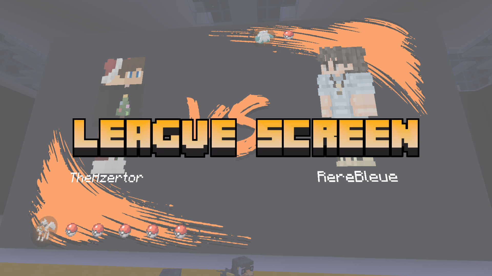
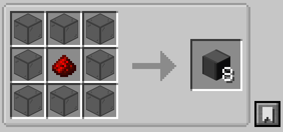
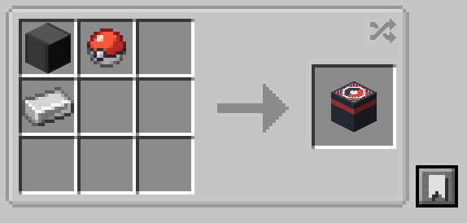
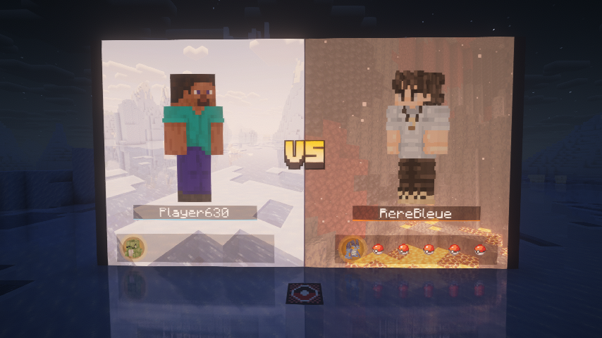
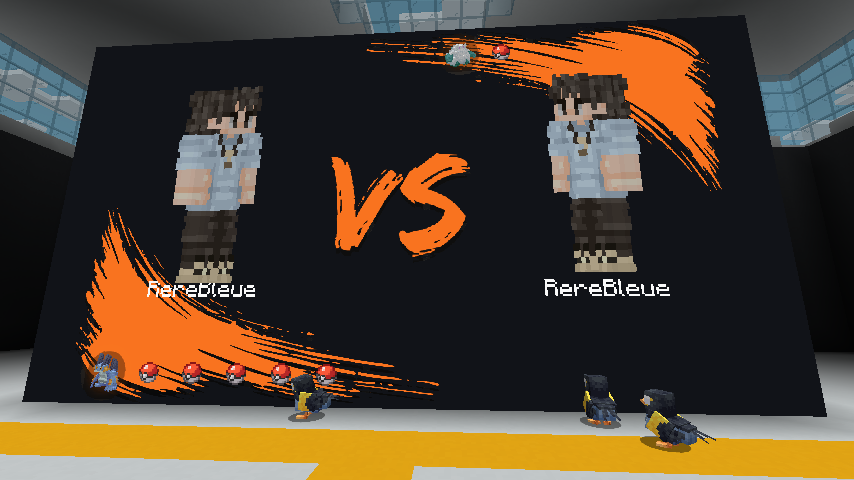

Cobblemon League Screen is an open source Minecraft mod which adds a screen to Cobblemon that follows the battle, like in anime league battles.

## Features

- **League Screen**: place screen blocks to build a wall of any size, and it shows the player's team and its status live
- **Registration Terminal**: link up to 8 screens, then click the terminal during a battle to show it on screen
- **Arena**: set a zone in the registration terminal, and the screen starts by itself when two trainers battle inside it
- **Themes**: change the screen's look from the terminal menu, or add your own themes with a data pack
- **Cobblemon Trainers** support (optional)

## Requirements

- Minecraft 1.21.1
- Fabric Loader 0.19.5+
- [Fabric API](https://modrinth.com/mod/fabric-api)
- [Fabric Language Kotlin](https://modrinth.com/mod/fabric-language-kotlin)
- [Cobblemon](https://modrinth.com/mod/cobblemon) 1.8.0+
- [Cobblemon Trainers](https://modrinth.com/mod/khlinTrc) 2.0.0+ (optional)

## Installation

Download the latest version from the [releases](https://github.com/matheo-1712/cobblemon-league-screen/releases) and drop the `.jar` into your `mods` folder.

## Crafting

### League Screen

### Registration Terminal

## Built-in themes

To change theme, sneak and right-click the registration terminal, then open the **Theme** tab.

<b>Ice & Fire</b> (default)

<b>Crown</b>

<b>Sun & Moon</b>

## Data packs

You can create your own screen themes with a data pack: colors, Pokémon placement, trainer portraits, images and texts. See the [data pack guide](https://github.com/matheo-1712/cobblemon-league-screen/blob/master/docs/DATAPACK.en.md).

This is where themes made by players will be listed, so you can change your screen's look without writing any.

*No themes yet.*

Made one you want listed? Open an [issue on GitHub](https://github.com/matheo-1712/cobblemon-league-screen/issues) with the link.

## License

This project is licensed under the [MIT License](https://github.com/matheo-1712/cobblemon-league-screen/blob/master/LICENSE).

## Contributors

- [matheo-1712](https://github.com/matheo-1712)
