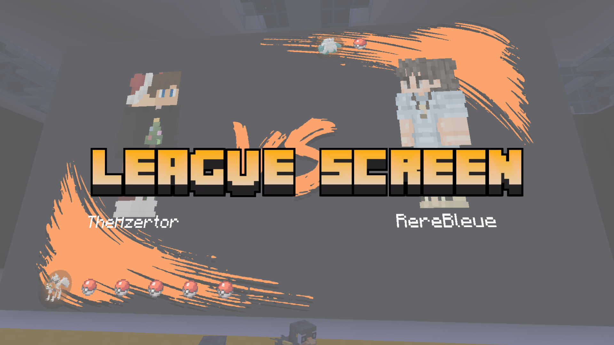
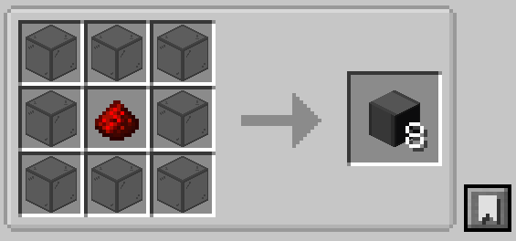
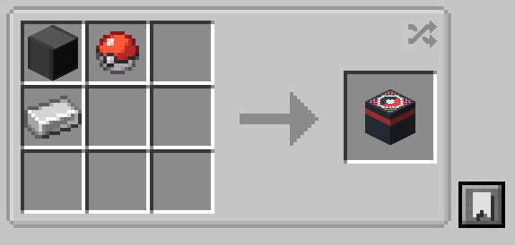
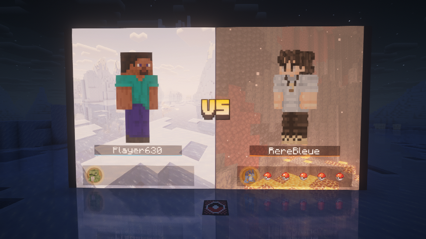
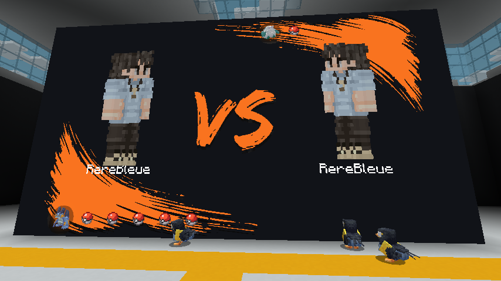
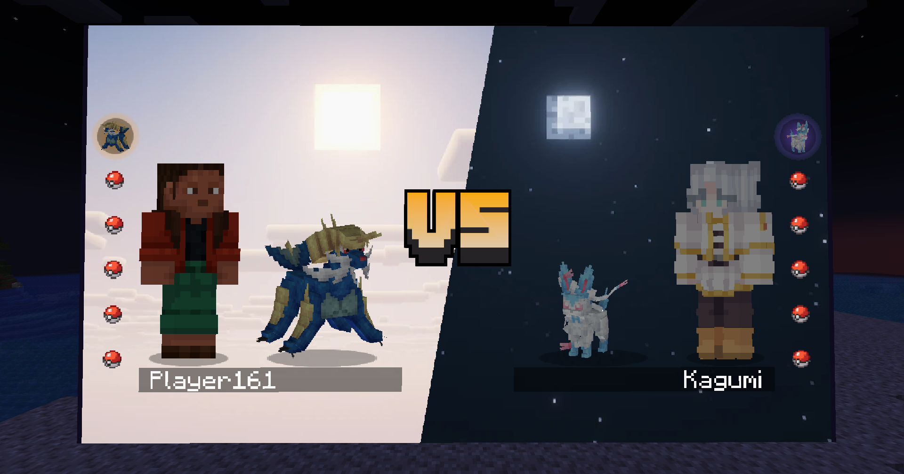

Cobblemon League Screen est un mod Minecraft open source qui ajoute un écran qui suit le combat comme dans les combats de ligue de l'anime à Cobblemon.

## Fonctionnalités

- **Écran de ligue** : pose des blocs d'écran pour construire un mur de la taille que tu veux, et il affiche l'équipe du joueur et son statut en direct
- **Terminal d'inscription** : relie jusqu'à 8 écrans, puis clique sur le terminal pendant un combat pour l'afficher à l'écran
- **Arène** : définis une zone dans le terminal d'inscription, et l'écran se lance tout seul quand deux dresseurs s'affrontent dedans
- **Thèmes** : change l'apparence de l'écran depuis le menu du terminal, ou ajoute tes propres thèmes avec un data pack
- Compatible avec **Cobblemon Trainers** (optionnel)

## Prérequis

- Minecraft 1.21.1
- Fabric Loader 0.19.5+
- [Fabric API](https://modrinth.com/mod/fabric-api)
- [Fabric Language Kotlin](https://modrinth.com/mod/fabric-language-kotlin)
- [Cobblemon](https://modrinth.com/mod/cobblemon) 1.8.0+
- [Cobblemon Trainers](https://modrinth.com/mod/khlinTrc) 2.0.0+ (optionnel)

## Installation

Télécharge la dernière version depuis les [releases](https://github.com/matheo-1712/cobblemon-league-screen/releases) et place le `.jar` dans ton dossier `mods`.

## Crafts

### Écran de ligue

### Terminal d'inscription

## Thèmes inclus

Pour changer de thème, accroupis-toi et fais un clic droit sur le terminal d'inscription, puis ouvre l'onglet **Thème**.

<b>Glace & Feu</b> (par défaut)

<b>Couronne</b>

<b>Soleil & Lune</b>

Le jour contre la nuit : chaque dresseur se tient à côté de son Pokémon sur le terrain, à sa taille réelle, et son équipe longe le bord de l'écran.

## Datapack

Tu peux créer tes propres thèmes d'écran avec un data pack : couleurs, place des Pokémon, portraits des dresseurs, images et textes. Tout est expliqué dans le [guide des data packs](docs/DATAPACK.fr.md).

Ici seront listés les thèmes créés par les joueurs, pour changer le look de ton écran sans rien écrire.

*Aucun thème pour l'instant.*

Tu as créé un thème et tu veux qu'il soit dans la liste ? Ouvre une [issue sur GitHub](https://github.com/matheo-1712/cobblemon-league-screen/issues) avec son lien.

## Licence

Ce projet est sous [licence MIT](LICENSE).

## Contributeurs
- [matheo-1712](https://github.com/matheo-1712)